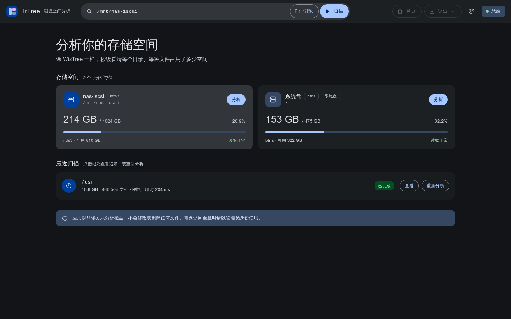
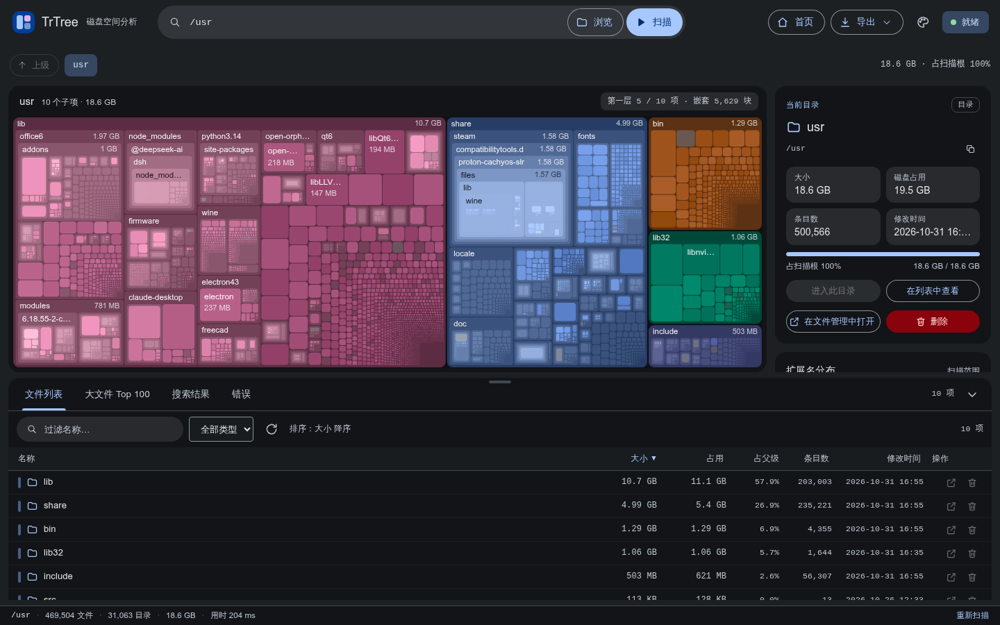
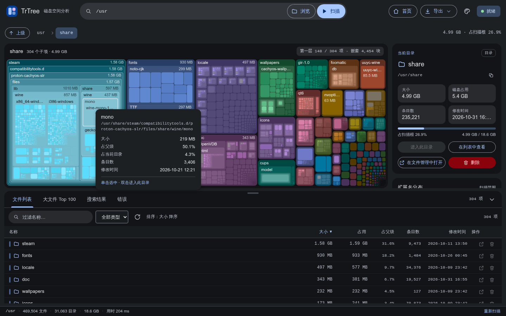
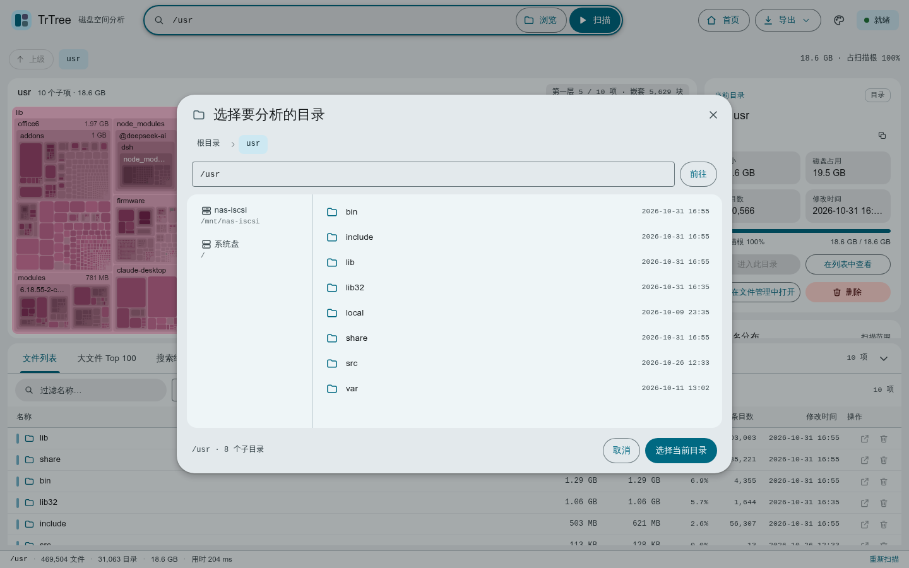
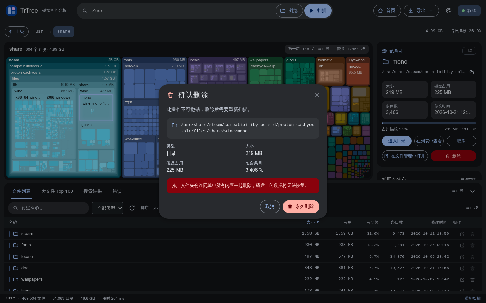
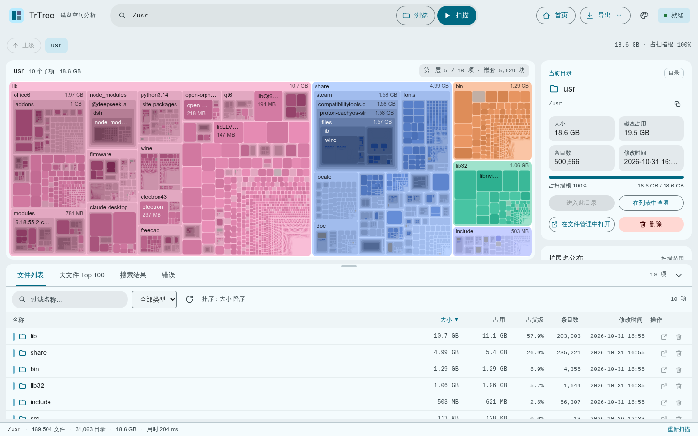

# TrTree · fnOS 磁盘空间分析

[](https://github.com/qmf9629/trim-trtree/actions/workflows/ci.yml)
[](https://github.com/qmf9629/trim-trtree/releases)
[](LICENSE)

像 Windows 上的 **WizTree** 一样，快速看清 fnOS 存储空间里每个目录、每种文件占用了多少空间。
纯原生 Go + HTML/CSS/JS 实现，无 Node/Python 运行时依赖，安装包同时支持 x86_64 与 arm64。

- 仓库：<https://github.com/qmf9629/trim-trtree>
- 下载：<https://github.com/qmf9629/trim-trtree/releases>
- 开发方式：使用 **DeepSeek** 辅助开发（设计、编码、调试与文档）



## 功能

- **秒级扫描**：并发遍历目录树，310 万级节点通常数秒内完成（取决于磁盘与元数据缓存）。
- **WizTree 式嵌套 Treemap**：目录块内部继续以子块显示子文件 / 子文件夹，同一分支同一色相、层级越深色深越不同，一眼看清"谁在谁里面"；同类文件同色。Canvas squarified 布局，面积即占用；悬停查看详情，单击选中，双击逐层钻取。
- **Material You 界面**：Material Design 3 风格，浅色 / 深色 / 跟随系统，6 种预设主题色或自定义取色，整套界面与 Treemap 配色随主题动态生成。
- **虚拟滚动列表**：按大小 / 名称 / 占用 / 条目数 / 修改时间排序，显示逻辑大小、磁盘占用、占父级比例。
- **全局搜索**：按名称搜索，可过滤文件 / 目录与最小大小；结果可直接定位到所在层级。
- **大文件 Top 100 / 1000**：快速找出最占空间的文件。
- **扩展名统计**：按文件类型汇总大小与数量。
- **CSV / JSON 导出**：完整路径、类型、大小、占用、修改时间、条目数；CSV 带 BOM，Excel 直接打开。
- **在文件管理器中打开**：对任意文件/目录一键跳到 fnOS 文件管理器的所在位置（通过桌面壳桥接 `openFileManager`，与官方微应用一致）。默认用**普通用户视角**；只有别人的共享目录、团队文件、系统目录等普通用户看不见的位置才自动切到管理员「全部文件」视角。
- **列表行内操作**：文件列表每一行都有「打开所在位置」「删除」按钮，无需先选中再看侧栏。
- **删除条目**：可直接永久删除文件或整个目录，需二次确认并显示路径、大小与条目数；删除后扫描结果自动失效并提示重新分析。
- **只读优先**：日常浏览只读取元数据；删除必须由管理员手动确认。



更多截图：

| 钻取 | 目录选择 |
| --- | --- |
|  |  |

| 删除二次确认 | 浅色主题 · 自定义主题色 |
| --- | --- |
|  |  |

## 安装

从 [Releases](https://github.com/qmf9629/trim-trtree/releases) 下载最新的 `trtree-<版本>.fpk`：

1. 打开 fnOS **应用中心 → 手动安装**，选择下载的 fpk 文件。
2. 安装完成后在应用中心**启动**（若首次安装后点图标打不开，执行「停止 → 启动」一次）。
3. 从桌面图标或应用中心打开 **TrTree 磁盘分析**。

也可以自行构建：`bash scripts/pack.sh` 会生成 `dist/trtree-<版本>.fpk`。

> 需要 fnOS `1.2.0401` 及以上版本，仅管理员可见/可用。
> 覆盖安装同一应用时，如果应用中心没有触发升级，请先卸载旧版本再安装新版本；扫描历史保存在应用数据目录，通常卸载后仍会保留，但内存中的扫描结果需要重新分析。

## 使用

1. 首页选择要分析的 **存储空间**，或点击 **浏览** 选择任意目录，再点击 **扫描**。
2. 扫描完成后默认显示 Treemap + 文件列表：
   - 单击色块 / 列表行：选中并在右侧查看详情；
   - 双击色块：进入该目录；列表行双击同样可钻取；
   - 顶部面包屑或 `↑` 返回上级；
   - 点击左上角 **TrTree** 标志或顶部 **首页** 按钮，随时返回概览页。
3. 底部标签页切换 **文件列表 / 大文件 Top 100 / 搜索结果 / 错误**。
4. 搜索：输入关键词即按名称过滤，支持"仅文件 / 仅目录"和最小大小。
5. 导出：右上角 **导出 → CSV / JSON**。
6. 历史扫描可在首页"最近扫描"中查看；结果只保存在内存中，应用重启后需要重新分析。

### 为什么需要 root 权限？

fnOS 的存储空间目录（如 `/vol1`、`/vol1/1000`）默认对普通用户不可枚举。TrTree 以 `run-as: root` 运行，
仅进行**只读**遍历与 `stat` 调用，不修改任何文件；API 层只对管理员开放，网关侧也配置为仅管理员可见。

## 开发

依赖：

- Go 1.24+（本仓库开发时使用 `.tools/go` 下的 Go 1.27）
- Python 3 + Pillow（仅生成图标）
- Node.js + Playwright（仅截图/端到端测试，可选）
- fnpack（打包 fpk，可选）

```bash
# 本地开发服务器（自动使用 src/web 作为静态目录）
bash scripts/dev.sh          # http://127.0.0.1:18080/

# 单元测试
bash scripts/test.sh

# 构建双架构二进制并打包 fpk
bash scripts/pack.sh         # dist/trtree-1.2.0.fpk
```

本地开发模式默认 `TRTREE_ALLOW_ALL=1`，不需要 fnOS 网关注入管理员头；生产环境由网关传递
`X-Trim-Userid` / `X-Trim-Isadmin`，应用只接受管理员请求。

打包默认优先使用官方 `fnpack`（放在 `.tools/fnpack` 或 PATH 中）；
没有时自动退回纯 Python 打包器 `scripts/fpk.py`，产物结构、权限与 manifest
`checksum` 均等价，已在实际 fnOS 设备上验证可正常安装启动。

发布：打 `v*` tag 会触发 `.github/workflows/release.yml`，自动构建双架构 fpk
并创建 Release 附带安装包与 `SHA256SUMS.txt`。

```bash
git tag v1.2.0 && git push origin v1.2.0
```

### 目录结构

```
main.go                 入口：embed 前端、Unix Socket / TCP 监听、内存上限
internal/api            HTTP 路由、任务管理、DTO、导出
internal/scan           目录树（紧凑并行切片）、并发扫描器、扩展名/Top 统计
internal/sysinfo        存储空间探测（/proc/mounts、statfs、去重）
src/web                 原生前端（index.html + css + ES modules）
packaging/              fnOS 安装包模板（manifest/config/cmd/ui）
scripts/                build / pack / dev / test / 图标生成
docs/                   API、前端规范、架构、打包说明、截图
tools/                  mock server、Playwright 截图脚本
```

### 关键设计

- **紧凑树**：并行切片存储 `name/parent/size/alloc/mtime/type/firstChild/...`，逆序一遍完成聚合，
  4M 节点约数百 MB 内存；超过上限会标记 `truncated`。
- **扫描**：BFS + worker pool（CPU×4，最多 32），`ReadDir(-1)` 批量读取，`st_blocks*512` 取真实磁盘占用。
- **挂载边界**：默认不跨文件系统；使用 `/proc/self/mounts` 判断挂载点，而不是 `st_dev`，
  因为 btrfs 子卷（如 `/vol1/1000`）会有不同的 `st_dev` 但并不是独立挂载。
- **网关**：`micro_app = true`，`gatewayPrefix=/app/trtree`，`gatewaySocket=app.sock`；应用只监听 Unix Socket。
- **内存保护**：启动时按系统内存的 65% 设置 `GOMEMLIMIT`，避免小内存 NAS 被 OOM。

## API

完整接口见 [docs/API.md](docs/API.md)。应用同时支持 TCP 调试模式（`TRTREE_PORT`）与 fnOS Unix Socket。

## 常见问题

**扫描结果比 `du` 小？**
默认不跨文件系统，会跳过 Docker overlay、iSCSI 等独立挂载点；可在代码/接口中关闭 `oneFilesystem`。
另外 btrfs 的压缩/共享 extent 会让"逻辑大小"和"磁盘占用"不同，界面两者都显示。

**扫描很慢 / 只扫到一部分？**
首次扫描需要读取大量元数据；机械硬盘或冷缓存会明显变慢。节点超过 400 万时结果会被截断（状态栏提示）。

**"错误"标签页有记录？**
表示某些目录无权限读取（例如系统保留目录），不影响其余结果。

**安装后显示"运行中"但打不开？**
部分 fnOS 版本通过 CLI 安装后，应用中心的状态可能先于进程就绪。请在应用中心先 **停止**，再 **启动** 一次；
命令行等价操作：`sudo appcenter-cli stop trtree && sudo appcenter-cli start trtree`。

**升级后版本没变？**
`appcenter-cli install-fpk` 对已安装的同名应用可能直接返回"已安装"而不覆盖；请先卸载旧版本再安装新版本，
或使用应用中心的本地升级入口。卸载不会删除 `@appdata` 中的扫描历史，但内存中的扫描结果需要重新分析。

### 实测数据

在 fnOS 1.2.0800 / Intel N100 / 3.6 GiB 内存的设备上，扫描 `/vol1`（btrfs，约 2.9 TB 已用）：

- 422,881 个节点，耗时约 1–2 秒，0 个读取错误；
- 常驻内存约 95 MB；
- 全局搜索约 25 ms，扩展名统计 < 1 ms，目录 CSV 导出（7.7 MB）约 120 ms。

## 关于开发

本项目使用 [DeepSeek](https://www.deepseek.com/) 辅助开发：从架构设计、Go 后端、
Canvas Treemap 前端到 fnOS 打包与调试，均由作者与 DeepSeek 协作完成。

遇到问题欢迎到 [Issues](https://github.com/qmf9629/trim-trtree/issues) 反馈。

## 许可证

MIT，见 [LICENSE](LICENSE)。
